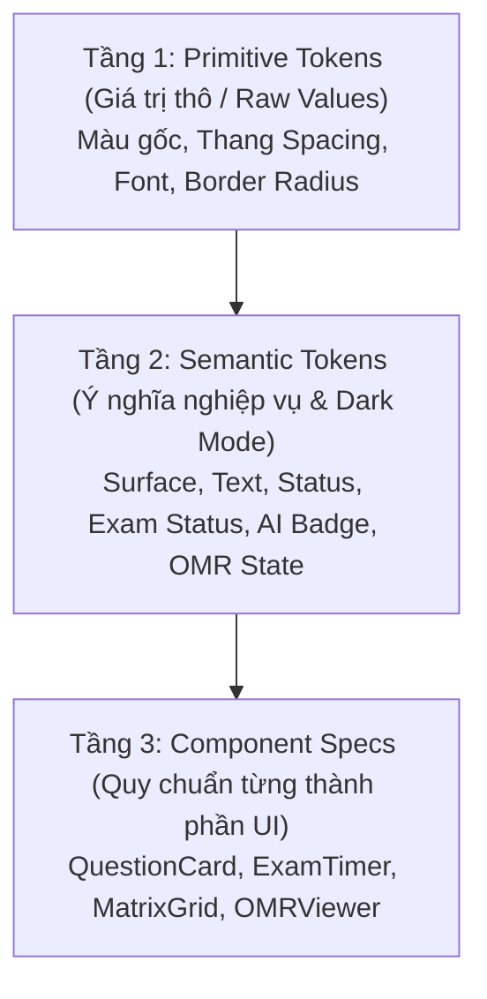

# OLMS Design System & Token Architecture

Hệ thống Design Tokens chuẩn hóa cho giao diện Frontend OLMS (Online Learning & Examination Management System), được thiết kế theo kiến trúc 3 tầng (3-Layer Token Architecture) tuân thủ skill `design-system` và `ui-styling`.

---

## 1. Cấu trúc 3 tầng Tokens (3-Layer Architecture)



1. **Primitive Tokens (`tokens.json` -> `primitive`)**:
   - Thang màu thương hiệu xanh Navy/Indigo học thuật (`#2563EB`, `#1D4ED8`, `#1E40AF`).
   - Thang màu trung tính Slate/Gray, thang đo khoảng cách 4px-base, radius, typography.
2. **Semantic Tokens (`tokens.json` -> `semantic` & `tokens.css`)**:
   - Trạng thái bề mặt (`surface-canvas`, `surface-card`, `surface-border`).
   - Ngữ cảnh học tập & thi cử:
     - **Exam Autosave Status**: `exam-status-saved` (xanh lá), `exam-status-saving` (hổ phách), `exam-status-unanswered` (xám viền đứt), `exam-status-flagged` (tím nhạt).
     - **Exam Countdown Timer**: `timer-normal` (trung tính), `timer-warning` (< 5 phút), `timer-critical` (< 1 phút đập nhịp).
     - **AI Similarity Warning**: `ai-similarity-badge` & `ai-override-notice` phục vụ cảnh báo trùng ý tưởng câu hỏi.
     - **OMR Bubble Status**: `omr-bubble-valid`, `omr-bubble-invalid`, `omr-bubble-ambiguous` (chấm phiếu trắc nghiệm).
3. **Component Specs (`tokens.json` -> `component`)**:
   - Quy chuẩn chi tiết cho `questionCard`, `examTimer`, `matrixGridCell`, `omrBubble`.

---

## 2. Hướng dẫn tích hợp Frontend (React / Vite / Next.js)

### Cách 1: Sử dụng qua CSS Variables (`tokens.css`)
Import trực tiếp vào file CSS gốc (`index.css` hoặc `globals.css`):
```css
@import './design-tokens/tokens.css';
```
Hỗ trợ chuyển đổi giao diện sáng/tối tự động bằng cách gán class `.dark` vào thẻ `<html>` hoặc `<body>`.

### Cách 2: Tích hợp với Tailwind CSS (`tailwind.config.js`)
Trong file `tailwind.config.js` của ứng dụng Frontend:
```javascript
const olmsTokens = require('./design-tokens/tailwind.tokens.js');

module.exports = {
  darkMode: 'class',
  content: ['./src/**/*.{js,jsx,ts,tsx}'],
  theme: {
    extend: {
      ...olmsTokens.theme.extend,
    },
  },
  plugins: [],
};
```

---

## 3. Ví dụ triển khai Component thực tế

### 3.1. Thẻ câu hỏi khi thi trực tuyến (`QuestionCard`)
```tsx
export function QuestionCard({ questionNo, status, content, children }) {
  // status: 'saved' | 'saving' | 'unanswered' | 'flagged'
  const borderStyles = {
    saved: 'border-exam-saved bg-surface-card',
    saving: 'border-exam-saving animate-pulse',
    unanswered: 'border-surface-border border-dashed',
    flagged: 'border-exam-flagged bg-purple-50/10',
  };

  return (
    <div className={`p-4 rounded border transition-colors ${borderStyles[status]}`}>
      <div className="flex items-center justify-between mb-3">
        <span className="font-semibold text-text-primary">Câu {questionNo}</span>
        <span className="text-xs text-text-secondary">{status.toUpperCase()}</span>
      </div>
      <div className="text-text-primary text-sm leading-relaxed mb-4">{content}</div>
      <div>{children}</div>
    </div>
  );
}
```

### 3.2. Đồng hồ đếm ngược phòng thi (`ExamTimer`)
```tsx
export function ExamTimer({ remainingSeconds }) {
  const isCritical = remainingSeconds < 60;
  const isWarning = remainingSeconds < 300 && !isCritical;

  const timerColor = isCritical
    ? 'text-timer-critical animate-bounce'
    : isWarning
    ? 'text-timer-warning'
    : 'text-timer-normal';

  const formatTime = (secs) => {
    const m = Math.floor(secs / 60).toString().padStart(2, '0');
    const s = (secs % 60).toString().padStart(2, '0');
    return `${m}:${s}`;
  };

  return (
    <div className="flex items-center space-x-2 font-mono text-lg font-bold">
      <span className={timerColor}>{formatTime(remainingSeconds)}</span>
    </div>
  );
}
```

---

## 4. Danh mục File cấu thành
- `design-tokens/tokens.json`: Cấu trúc JSON nguồn gồm 3 tầng token.
- `design-tokens/tokens.css`: Định nghĩa CSS Variables hỗ trợ theme sáng & dark mode.
- `design-tokens/tailwind.tokens.js`: Adapter kết nối token vào Tailwind utility classes.
- `design-tokens/README.md`: Tài liệu hướng dẫn thiết kế và sử dụng.
